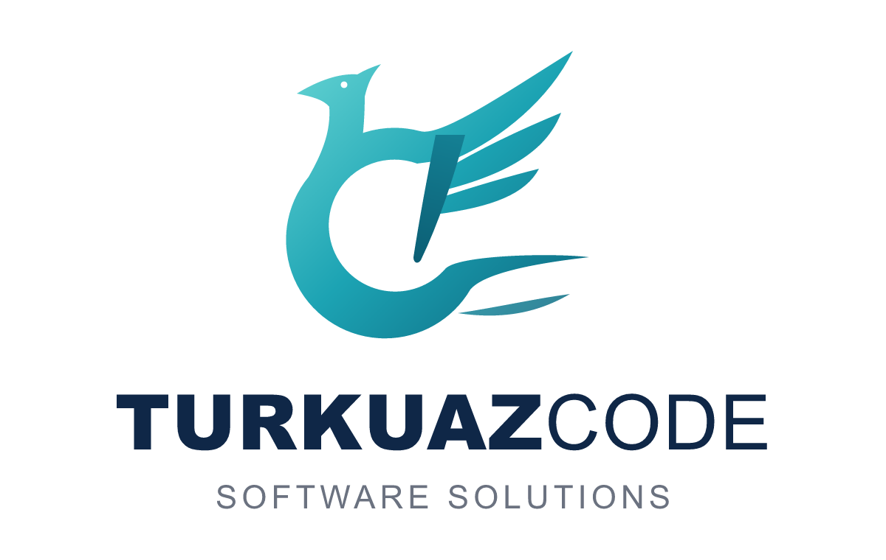

  <picture>
    <source media="(prefers-color-scheme: dark)" srcset="assets/logo-dark.png">
    
  </picture>

  <b>Software solutions from Türkiye.</b> 
  We build fast, private, open-source desktop applications.

  <a href="https://turkuazcode.com">turkuazcode.com</a> ·
  <a href="mailto:turkuazcode@gmail.com">turkuazcode@gmail.com</a>

---

## Products

### [HS Studio](https://github.com/turkuazcode/hs-studio)
A video player, photo studio and music player in one open-source desktop app.

- **Video:** libmpv + FFmpeg playback with subtitles, chapters, HDR tone mapping and hardware decoding, plus model-free video enhancement
- **Photo:** viewer and studio with EXIF, histogram, crop/rotate, batch conversion, HEIC/AVIF and RAW previews
- **Music:** library, playlists, gapless playback and ReplayGain
- **Safe by design:** originals are never modified, and the app works offline in Turkish and English

Built with Tauri 2, Rust and libmpv (LGPL). Alpha on Windows 11 x64; Linux builds are a preview.

## What we do

- Desktop applications for Windows and Linux
- Media processing: video, photo and audio
- Rust and TypeScript development

## Contact

For projects, partnerships or questions, email **turkuazcode@gmail.com** or visit **[turkuazcode.com](https://turkuazcode.com)**.

To report a security issue, use the private **Report a vulnerability** form in the repository's *Security* tab.
