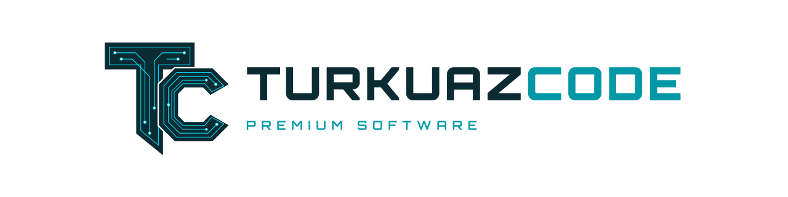

  <picture>
    <source media="(prefers-color-scheme: dark)" srcset="assets/banner-dark.svg">
    
  </picture>

  <b>Software solutions from Türkiye.</b> 
  AI-powered SaaS platforms, mobile apps and desktop software.

  <a href="https://turkuazcode.com">turkuazcode.com</a> ·
  <a href="mailto:turkuazcode@gmail.com">turkuazcode@gmail.com</a>

---

## Products

### Education and publishing
- **Publishing platform:** question banks, AI-assisted question and solution writing, and test booklet typesetting for publishers, with PDF and Word export. Every AI output is reviewed by an editor before it is published.
- **Mirror question platform:** students scan a test's QR code in an exam-prep book and get practice versions of that test, with results, rankings and solutions.
- **Learning center management:** a multi-tenant platform for tutoring centers, with mobile apps for teachers, students and parents, AI-supported learning and optical answer sheet reading.

### TurkuazChat
A 24/7 AI customer assistant for stores that sell on Instagram and WhatsApp. It answers DMs, comments and messages in natural Turkish.

### Public sector
Mobile apps for municipal services: news, citizen requests and an AI assistant over official documents, built with data privacy in mind (KVKK).

### [HS Studio](https://github.com/turkuazcode/hs-studio) — open source
A video player, photo studio and music player in one open-source desktop app.

- **Video:** libmpv + FFmpeg playback with subtitles, chapters, HDR tone mapping and hardware decoding, plus model-free video enhancement
- **Photo:** viewer and studio with EXIF, histogram, crop/rotate, batch conversion, HEIC/AVIF and RAW previews
- **Music:** library, playlists, gapless playback and ReplayGain
- **Safe by design:** originals are never modified, and the app works offline in Turkish and English

Built with Tauri 2, Rust and libmpv (LGPL). Alpha on Windows 11 x64; Linux builds are a preview.

## What we do

- Multi-tenant SaaS platforms with web panels and mobile apps
- Applied AI: content generation, customer assistants and document search (RAG)
- Mobile apps (Flutter, React Native) and desktop apps (Tauri, Rust)
- Backends with NestJS, FastAPI, Django and PostgreSQL

## Contact

For projects, partnerships or questions, email **turkuazcode@gmail.com** or visit **[turkuazcode.com](https://turkuazcode.com)**.

To report a security issue, use the private **Report a vulnerability** form in the repository's *Security* tab.
